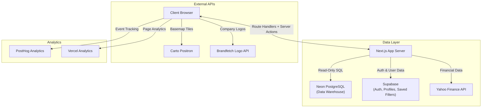

# Bamboo Reports By ResearchNXT

A modern Business Intelligence dashboard built with Next.js App Router, React, and TypeScript. The app delivers account, center, service, and prospect intelligence through rich filtering, data visualization, geospatial analytics, and export workflows.

[](https://vercel.com)
[](https://nextjs.org/)
[](https://react.dev/)
[](https://www.typescriptlang.org/)
[](https://tailwindcss.com/)
[](https://nodejs.org/)
[](https://supabase.com)
[](https://neon.tech/)
[](https://posthog.com/)
[](https://maplibre.org/)


---

## Table of Contents

- [Overview](#overview)
- [Key Features](#key-features)
- [Architecture & Data Flow](#architecture--data-flow)
- [Tech Stack](#tech-stack)
- [Project Structure](#project-structure)
- [Getting Started](#getting-started)
- [Environment Variables](#environment-variables)
- [Authentication & Authorization](#authentication--authorization)
- [Database & Schema](#database--schema)
- [Analytics & Monitoring](#analytics--monitoring)
- [Deployment](#deployment)
- [Troubleshooting](#troubleshooting)
- [Documentation Reference](#documentation-reference)

---

## Overview

Bamboo Reports provides a unified view of business entities (**Accounts**, **Centers**, **Services**, **Functions**, **Tech**, and **Prospects**). The dashboard combines high-performance data grids with geospatial analytics and charting to empower decision-makers.

### Core Value Proposition
- **High Signal-to-Noise:** Designed for rapid filtering and drilling down into large datasets.
- **Geospatial Intelligence:** Visualize delivery center density with clustered markers and state-level choropleth maps.
- **Persistence:** Save complex filter configurations to the cloud (Supabase) for recurring reporting tasks.
- **Exportability:** Generate boardroom-ready Excel reports with multi-sheet support and company logos.
- **Real-Time Notifications:** Track recently updated accounts and table records with an in-app notification system.

---

## Key Features

### Dashboard and Insights
- **Smart Summary Cards:** Real-time filtered vs. total counts per entity.
- **Interactive Charts:** Highcharts donut charts and a technology treemap for categorical breakdowns (Country, Industry, Revenue, Headcount, Technology), plus a Recharts revenue trend chart in the Account details dialog.
- **Tabbed Navigation:** Switch between Accounts, Centers, Prospects, and Services tabs.
- **Deployment-Level Access Control:** Accounts, Centers, and Prospects can be enabled or disabled per deployment via `lib/config/dashboard-access.ts`.
- **Geospatial Analytics:**
  - MapLibre cluster map optimized for 5000+ center points over a keyless Carto basemap.
  - State-level choropleth map using local Survey of India administrative boundaries.

### Advanced Filtering Engine
- **Multi-Select Filters:** Country, Region, Industry, Category, Nature, Technology, Functions, and more.
- **Server-Side Filtering (#249):** Filters are translated to parameterized SQL on the server and the client reads paginated slices and pre-computed aggregates; no endpoint returns the whole dataset. See [Server-Mode Dashboard](documentation/backend/server-dashboard-mode.md).
- **Account Visibility Filter:** `ALL` / `GCCs` / `NON-GCCs` toggle (default `GCCs`) constrains tables, charts, and exports to the chosen account set, while summary cards still report the full universe.
- **Alias-Aware Account Search:** Global search and the account filter autocomplete match accounts by alternate names (short legal name, brand, abbreviation, flagship products, "currently known as") and show a "Known as" hint on alias matches.
- **Precision Slicing:** "Include" vs. "Exclude" toggle per filter group.
- **Range Sliders:** Revenue, Employee count, and Years in India sliders with logarithmic scaling.
- **Premium Filter Reveal:** Accounts and Centers support config-driven `Show More` premium filters via `lib/config/filters.ts`.
- **Saved Filters:** Persist complex filter sets to Supabase with Row-Level Security isolation.
- **Account Lists:** Upload a client's own account list (`lib/accounts`), map it to warehouse accounts via `POST /api/accounts/match` (alias-aware), and apply it as an Account List filter; lists can be reused in saved filters and shared. See [Account Lists](documentation/backend/account-lists.md).
- **Engaged Prospects:** An `Engaged` prospect filter (`prospect_engaged`), plus a campaign touchpoint timeline in the prospect dialog served by `GET /api/prospects/[id]/engagements` from the `subscribers` table (`lib/dashboard/engagements.ts`).
- **Filter Sharing:** Share a saved filter with a specific teammate by email; the recipient gets read access to that one filter only.
- **Debounced Search:** 300ms debounce on keyword inputs to optimize performance.
- **Active Filter Count:** Visual badge indicator showing the number of applied filters.

### Data Management
- **Paginated Tables:** 50 items per page, optimized for performance with `React.memo`.
- **Row-Level Details:** Comprehensive tabbed dialog views for Accounts, Centers, and Prospects.
- **Type Safety:** Shared TypeScript definitions ensuring consistency from database to UI.

### Export and Integrations
- **Server-Side `.xlsx` Exports:** ExcelJS builds multi-sheet workbooks on the server against a full-schema `SELECT *`, so exports include every database column regardless of what the dashboard renders.
- **Filter-Aware:** The client sends account / center identifier lists (or, in server mode, the filter set itself) so filtered exports only include matching rows; unfiltered exports pull the full tables.
- **Audit Log + Re-Download:** Every export is archived to a private Supabase Storage bucket and logged in `public.user_exports` with IP, user-agent, filters snapshot, and row counts. Users re-download past exports from the **My exports** dialog via short-lived signed URLs.
- **Summary PDF:** Download the filtered summary counts and the active filter list as an A4 PDF (`lib/reports`, rendered with jsPDF, loaded lazily).
- **Logo Integration:** Automated company logo fetching via the Brandfetch Logo API with monogram fallbacks.
- **Financial Data:** Stock information and financial metrics via Yahoo Finance integration.

> **Details:** See [User Exports & Audit Log](documentation/backend/user-exports.md) for the architecture, setup steps, and troubleshooting.

### Notifications
- **Recently Updated Accounts:** Tracks account-level changes with grouped notifications.
- **Recently Updated Records:** Table-level update summaries across all entities.
- **Unread Count Badge:** Bell icon with visual count indicator.
- **Feature Flag:** Toggle via `NEXT_PUBLIC_NOTIFICATIONS_ENABLED` environment variable.

### Personalization
- **Recently Viewed History:** Automatic tracking of recently opened detail dialogs.
- **Guided Product Tour:** Auto-starting, replayable `driver.js` walkthrough for first-time users, with per-browser and per-account completion tracking.

> **Details:** See [Filter Sharing](documentation/backend/filter-sharing.md) and [Product Tour](documentation/frontend/product-tour.md).

---

## Architecture & Data Flow

The application follows a **Server-First** data architecture with **Client-Side** interactivity.



### Data Fetching Strategy
1. **Initial Load:** The client requests the summary counts, filter facets, charts and the first page of each table from dedicated Route Handlers. No endpoint returns the whole dataset (the full-payload `GET /api/dashboard` route and client-side filtering were retired on 2026-09-05).
2. **Filtering:** User actions update React state (`hooks/use-dashboard-filters.ts`); `hooks/use-server-dashboard-data.ts` sends the filter set to the server, which filters and aggregates in SQL.
3. **Route Handlers and Server Actions:** Warehouse reads go through `app/api/**` Route Handlers built on `lib/dashboard/filtering-sql.ts`; user-data operations use action files (`app/actions/notifications.ts`, `app/actions/system.ts`) and the Supabase client directly.
4. **Runtime Behavior (#249):** Filters are translated to SQL on the server and the client reads paginated/aggregated slices from dedicated endpoints (`/api/dashboard/summary`, `/api/dashboard/facets`, `/api/dashboard/charts`, `/api/{accounts,centers,prospects}/query`, `/api/search`, `/api/centers/map`). Responses are cached in a two-tier cache (in-memory L1 + Upstash Redis L2) keyed on the filter state and purged by the ETL after each import. See [Server-Mode Dashboard](documentation/backend/server-dashboard-mode.md) and [Caching and Rate Limiting](documentation/backend/caching-and-rate-limiting.md).

---

## Tech Stack

Next.js 16 (App Router) with React 19 and TypeScript, Tailwind CSS with shadcn/ui on Radix primitives, Highcharts and Recharts, MapLibre GL, Neon PostgreSQL via Prisma for the warehouse, Supabase for auth and user data, Upstash Redis for caching and rate limits, ExcelJS and jsPDF for exports, PostHog and Vercel Analytics, and Vitest for tests.

Versions, rationale and architecture decisions live in the **[Tech Stack Reference](documentation/tech-stack.md)**, which is the single source for this information.

---

## Project Structure

```
bamboo-reports-main/
├── app/              # Next.js App Router: pages, Route Handlers (api/), Server Actions (actions/)
├── components/       # React components, grouped by feature
├── contexts/         # React context providers (notifications, account lists)
├── hooks/            # Custom React hooks
├── lib/              # Server and client modules: dashboard SQL, cache, auth, exports, config
├── etl/              # Python ETL, one uv project (see documentation/backend/etl-pipeline.md)
├── prisma/           # Prisma schema for the Neon warehouse
├── tests/            # Vitest suites (see documentation/testing-guide.md)
├── public/           # Static assets (logos, images, boundary GeoJSON)
└── documentation/    # Technical docs (see Documentation Reference below)
```

The per-directory breakdown (every `components/`, `hooks/` and `lib/` module and what it owns) lives in **[Project Architecture, section 2](documentation/project-architecture.md#2-directory-structure--responsibilities)**.

---

## Getting Started

### Prerequisites
- **Node.js 20.9+**
- **npm** (v9+)
- **Neon PostgreSQL:** Connection string for the data warehouse.
- **Supabase Project:** For authentication and user state.

### Installation

1. **Clone the Repository:**
    ```bash
    git clone https://github.com/Bamboo-Reports/bamboo-reports-main.git
    cd bamboo-reports-main
    ```

2. **Install Dependencies:**
    ```bash
    npm install
    ```

3. **Environment Setup:**
    Duplicate the example file and fill in your secrets.
    ```bash
    cp .env.example .env.local
    ```

4. **Run Development Server:**
    ```bash
    npm run dev
    ```
    Open [http://localhost:3000](http://localhost:3000) to view the app.

### Available Scripts

| Command | Description |
|---------|-------------|
| `npm run dev` | Start development server with hot reload |
| `npm run build` | Create production build |
| `npm run start` | Start production server |
| `npm run lint` | Run ESLint checks |
| `npm run typecheck` | Run TypeScript compiler checks |
| `npm run test` | Run Vitest test suite |
| `npm run test:watch` | Run Vitest in watch mode |
| `npm run prisma:generate` | Regenerate the Prisma Client after schema changes |

---

## Environment Variables

| Variable | Required | Description |
|----------|----------|-------------|
| `DATABASE_URL` | **Yes** | Neon PostgreSQL pooled runtime connection string used by Prisma Client. |
| `DIRECT_URL` | No | Direct Neon connection string for Prisma CLI commands. Falls back to `DATABASE_URL`. |
| `NEXT_PUBLIC_SUPABASE_URL` | **Yes** | Your Supabase project URL. |
| `NEXT_PUBLIC_SUPABASE_ANON_KEY` | **Yes** | Supabase public anon key (safe for client). |
| `SUPABASE_SERVICE_ROLE_KEY` | **Yes** | Supabase service-role secret. Server-only. Used to write/read `user_exports` and upload archived exports to Storage. |
| `DASHBOARD_CACHE_TTL_MS` | No | Response cache TTL. Code default: `600000` (10 min); recommended `691200000` (8 days) since the ETL purges the cache after each weekly import. |
| `EXPORT_RATE_LIMIT_PER_HOUR` | No | Max data exports per user per rolling hour. Default: `20`. |
| `NEXT_PUBLIC_BRANDFETCH_CLIENT_ID` | No | Brandfetch Logo API client ID. Without it the UI shows monogram fallbacks. |
| `DATA_RATE_LIMIT_PER_MIN` | No | Max requests per user per minute on data endpoints. Default: `60`. |
| `UPSTASH_REDIS_REST_URL` / `UPSTASH_REDIS_REST_TOKEN` | No | Upstash Redis credentials for the L2 response cache (`KV_REST_API_URL` / `KV_REST_API_TOKEN` also accepted). Also backs the rate-limit counters. Without them the cache runs L1-only and rate limiting uses the Supabase `increment_rate_limit` RPC. |
| `NEXT_PUBLIC_POSTHOG_KEY` | No | PostHog project API key for analytics. |
| `NEXT_PUBLIC_POSTHOG_HOST` | No | PostHog host URL. Leave unset to use the `/ingest` reverse proxy in `next.config.mjs`. |
| `NEXT_PUBLIC_ENABLE_ANALYTICS` | No | Set to `true` to enable PostHog during local development. |
| `NEXT_PUBLIC_POSTHOG_DEBUG` | No | Set to `true` to enable PostHog debug logging. |
| `NEXT_PUBLIC_NOTIFICATIONS_ENABLED` | No | Feature flag: `enabled` or `disabled`. |
| `NEXT_PUBLIC_MAINTENANCE_MODE` | No | Set to `true` to show a maintenance page instead of the dashboard. |
| `NEXT_PUBLIC_ENVIRONMENT_LABEL` | No | Environment tag displayed in the UI: `DEV`, `PROD`, or empty. |

---

## Deployment Config

Two local config files control client-specific packaging without changing the core dashboard:

- `lib/config/dashboard-access.ts`
  - Controls whether top-level sections like `accounts`, `centers`, and `prospects` are accessible.
  - The same config is respected by dashboard navigation, search, exports, and server-side export enforcement.
- `lib/config/filters.ts`
  - Controls which individual filters are enabled.
  - Also controls premium `Show More` behavior for Account and Center filters via `showMoreEnabled` and `premiumFilterKeys`.

Typical use cases:

- Client only needs Accounts + Prospects:
  - Set `centers` to `"disabled"` in `lib/config/dashboard-access.ts`
- Client has standard filters only:
  - Set `showMoreEnabled: false` for the relevant filter section in `lib/config/filters.ts`

---

## Authentication & Authorization

The app delegates identity management to **Supabase Auth**.

- **Sign Up/Login:** Standard Email/Password flow.
- **Session Persistence:** Browser-side via `@supabase/supabase-js`. "Remember me" keeps the session in `localStorage`; unchecked, it lives in `sessionStorage` and ends with the tab. API routes receive the access token as a Bearer header and verify it server-side (see RBAC & Auth Guards).
- **Auth Screens:** Sign in, sign up, forgot password and reset password share one card frame (`components/auth/auth-shell.tsx`) built on the brand frame described in [Standalone Screens](documentation/frontend/standalone-screens.md).
- **Role-Based Access Control:**
  - `viewer`: Read-only access to the dashboard.
  - `admin`: Read access plus data export capabilities.
- **User Data:**
  - **`public.profiles`**: Stores user metadata (First Name, Last Name, Email, Role).
  - **`public.saved_filters`**: Stores JSON blobs of user's filter configurations.
  - **`public.user_exports`**: Audit log of exports with metadata (IP, user-agent, row counts, filters snapshot). Pairs with the private `user-exports` Storage bucket for the archived `.xlsx` files.
- **Security:** Row-Level Security (RLS) ensures full data isolation between users.

> **Setup Guides:**
> - Auth & profiles: [Supabase Auth Setup](documentation/backend/supabase-auth-setup.md)
> - Exports audit log + bucket: [User Exports & Audit Log](documentation/backend/user-exports.md)

---

## Database & Schema

The core BI data resides in **Neon PostgreSQL**. All tables follow strict `snake_case` naming.

### Core Tables
| Table | Description | Database primary key | ETL/logical identity or link |
|-------|-------------|----------------------|------------------------------|
| `accounts` | Top-level company entities with HQ details, financials, workforce | `account_global_legal_name` | `account_global_legal_name` |
| `ticker` | Stock ticker per account (one row per account) | `account_global_legal_name` | `account_global_legal_name` |
| `centers` | Delivery centers / office locations with geospatial data | `cn_unique_key` | `cn_unique_key` |
| `services` | Service-line rows linked to centers | *(none)* | `cn_unique_key` |
| `functions` | Function rows linked to centers | *(none)* | `cn_unique_key`, `function_name` |
| `tech` | Technology stack rows (software, vendors, categories) | *(none)* | `cn_unique_key` plus software fields |
| `prospects` | Contact/lead rows linked to accounts | *(none)* | `ps_unique_key` |
| `alias` | Alternate account names (brand, abbreviation, flagship products) | *(none)* | `account_global_legal_name` |
| `subscribers` | Campaign engagement rows (one per prospect per campaign) | *(none)* | `lower(prospect_email)` |

### Audit Tables (in `audit` schema)
- `audit.import_runs`: Data import tracking
- `audit.field_change_events`: Field-level audit log linked to `import_runs`
- `audit.notification_reads`: Notification read status per user, linked to `field_change_events`
- `audit.user_notification_state`: Per-user bookmark of the last read timestamp

### Key Relationships
- `alias` links to `accounts` via `account_global_legal_name` (cascades on delete)
- `centers` links to `accounts` via `account_global_legal_name` (cascades on delete)
- `services`, `functions`, and `tech` link to `centers` via `cn_unique_key` (cascades on delete)
- `prospects` links to `accounts` via `account_global_legal_name` (cascades on delete)
- `subscribers` links to `prospects` by case-insensitive email match (logical link, no FK)

> **Reference:** See the [Schema Migration Guide](documentation/backend/schema-migration-guide.md) for complete column definitions and table relationships.

---

## Analytics & Monitoring

### PostHog
Product analytics integrated via `posthog-js`. Tracks:
- Dashboard page views and session duration
- Filter interactions and saved filter usage
- Export actions and tab navigation
- User identification tied to Supabase user ID
- Session replay, dead clicks, and unhandled exceptions (plus errors caught by `app/global-error.tsx` and the map error boundary)

Events go through the `/ingest` reverse proxy in `next.config.mjs` so ad blockers do not drop them. Configuration: set `NEXT_PUBLIC_POSTHOG_KEY` (US Cloud project).

### Vercel Analytics
Page performance monitoring via `@vercel/analytics`. Automatically tracks Core Web Vitals when deployed on Vercel.

---

## Deployment

### Vercel (Recommended)

This project is optimized for Vercel.

1. **Push to GitHub.**
2. **Import in Vercel:** Select the repository.
3. **Configure Environment Variables:** Add all required keys from the table above.
4. **Deploy:** Vercel auto-detects Next.js and builds.

Subsequent pushes to the `main` branch trigger automatic deployments.

### Build Configuration

See [Tech Stack Reference, Build Configuration](documentation/tech-stack.md#build-configuration).

---

## Troubleshooting

Common problems and fixes are collected in **[Developer Workflow, Troubleshooting](documentation/developer-workflow.md#5-troubleshooting)**.

---

## Documentation Reference

Detailed documentation for specific subsystems lives in the `documentation/` folder:

| Document | Description |
|----------|-------------|
| [**Tech Stack**](documentation/tech-stack.md) | Comprehensive technology reference with versions, purposes, and categories |
| [**UI-to-Column Mapping**](documentation/frontend/ui-column-mapping.md) | Complete mapping of every UI label to its database column (filters, tables, dialogs, charts) |
| [**Project Architecture**](documentation/project-architecture.md) | High-level design, server actions, state management, and integrations |
| [**Schema Guide**](documentation/backend/schema-migration-guide.md) | Deep dive into the data model, column definitions, and migration history |
| [**Table Relationships**](documentation/backend/table-relationships.md) | Table hierarchy, primary keys, FK constraints, and ETL import order |
| [**ETL Pipeline**](documentation/backend/etl-pipeline.md) | The import process itself: source data, diffing, audit trail, how to extend it |
| [**Developer Workflow**](documentation/developer-workflow.md) | Guide for common tasks, coding standards, and troubleshooting |
| [**Testing Guide**](documentation/testing-guide.md) | Vitest setup, mocking patterns, and how to add a new test |
| [**Server-Mode Dashboard**](documentation/backend/server-dashboard-mode.md) | The #249 server-backed data path: endpoints, SQL filter translation, rollout state |
| [**Caching and Rate Limiting**](documentation/backend/caching-and-rate-limiting.md) | Two-tier response cache (L1 + Upstash Redis L2), cache purges, per-user rate limits |
| [**Account Lists**](documentation/backend/account-lists.md) | Uploading client account lists, name matching, the Account List filter, and sharing |
| [**Supabase Auth**](documentation/backend/supabase-auth-setup.md) | Setting up the `profiles` table, RLS policies, and auth triggers |
| [**RBAC & Auth Guards**](documentation/backend/rbac-and-auth-guards.md) | Role enforcement, client-side session guard, server-side token verification |
| [**Saved Filters**](documentation/backend/supabase-saved-filters.md) | Technical spec for the saved filters JSON structure |
| [**Filter Sharing**](documentation/backend/filter-sharing.md) | Filter-sharing table, RLS model, lookup functions, and Supabase migration order |
| [**User Exports & Audit Log**](documentation/backend/user-exports.md) | Server-side export generation, Storage archive, and audit table |
| [**Product Tour**](documentation/frontend/product-tour.md) | Guided onboarding walkthrough, completion tracking, and versioning |
| [**Logo Integration**](documentation/frontend/logo-integration.md) | Setup and usage guide for the Brandfetch logo integration |
| [**Map Boundaries**](documentation/frontend/map-disputed-boundaries.md) | Carto basemap and local Survey of India boundary behavior |
| [**Standalone Screens**](documentation/frontend/standalone-screens.md) | Brand frame for auth, error, 404 and maintenance screens; full-page loading skeleton; skeleton conventions |

---

## License

Proprietary software owned by ResearchNXT.
