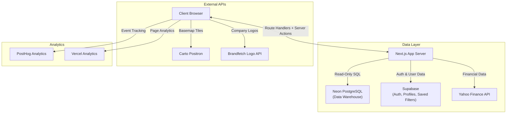

# Bamboo Reports by ResearchNXT

Bamboo Reports is a business intelligence dashboard for accounts, centers, services and prospects, built with the Next.js App Router, React and TypeScript. Users filter the data, view it as tables, charts and maps, and export it to Excel or PDF.

<p align="center">
  
</p>

<p align="center">
  <a href="https://nextjs.org/"></a>
  <a href="https://react.dev/"></a>
  <a href="https://www.typescriptlang.org/"></a>
  <a href="https://tailwindcss.com/"></a>
  <a href="https://nodejs.org/"></a>
</p>

<p align="center">
  <a href="https://vercel.com"></a>
  <a href="https://supabase.com"></a>
  <a href="https://neon.tech/"></a>
  <a href="https://posthog.com/"></a>
  <a href="https://maplibre.org/"></a>
  
</p>

---

## Table of contents

- [Overview](#overview)
- [Features](#features)
- [Architecture and data flow](#architecture-and-data-flow)
- [Tech stack](#tech-stack)
- [Project structure](#project-structure)
- [Getting started](#getting-started)
- [Environment variables](#environment-variables)
- [Deployment config](#deployment-config)
- [Authentication and authorization](#authentication-and-authorization)
- [Database and schema](#database-and-schema)
- [Analytics and monitoring](#analytics-and-monitoring)
- [Deployment](#deployment)
- [Troubleshooting](#troubleshooting)
- [Documentation reference](#documentation-reference)
- [License](#license)

---

## Overview

The dashboard covers six entities: accounts, centers, services, functions, tech and prospects. The server filters and aggregates the data in SQL, and the browser receives one page of rows plus precomputed counts, so no request returns the whole dataset.

---

## Features

### Dashboard

- Summary cards show the filtered count and the total count for each entity.
- Highcharts donut charts break down accounts and centers by country, industry, revenue and headcount, and a treemap shows technologies. The account dialog adds a Recharts revenue trend chart.
- The Accounts and Centers tabs switch between chart, map and table views. The Prospects tab has chart and table views.
- `lib/config/dashboard-access.ts` turns the Accounts, Centers and Prospects sections on or off per deployment.
- The MapLibre cluster map plots 5,000+ center locations on a Carto basemap that needs no API key.
- A choropleth map shades Indian states by center count, using local Survey of India boundaries.

### Filtering

- Multi-select filters cover country, region, industry, category, nature, technology, functions and more. Each value can be included or excluded.
- The server turns filters into parameterized SQL and returns paginated rows and aggregates. See [Server-Mode Dashboard](documentation/backend/server-dashboard-mode.md).
- The `ALL` / `GCCs` / `NON-GCCs` toggle limits tables, charts and exports to that set of accounts. It defaults to `GCCs`. The total on each summary card still counts every account.
- Global search and the account filter match alternate account names, such as short legal names, brands, abbreviations, flagship products and former names. A "Known as" hint shows which alias matched.
- Range sliders filter by HQ revenue, years in India and center incorporation year.
- The account and center filter groups can hide premium filters behind `Show More`, configured in `lib/config/filters.ts`.
- Saved filters are stored in Supabase, and Row-Level Security limits each user to their own.
- A saved filter can be shared with a teammate by email. The recipient can read that one filter and nothing else.
- Users can upload a client's account list, which `POST /api/accounts/match` maps to warehouse accounts using aliases. The list then works as an Account List filter, and it can be saved with a filter and shared. The code is in `lib/accounts`. See [Account Lists](documentation/backend/account-lists.md).
- The `Engaged` prospect filter reads `prospect_engaged`. The prospect dialog shows a campaign timeline from the `subscribers` table, served by `GET /api/prospects/[id]/engagements` and built in `lib/dashboard/engagements.ts`.
- Account name search waits 300 ms after the last keystroke before it queries the server.
- A badge shows how many filters are active.

### Tables and records

- Tables show 51 rows per page, and each row component is memoized with `React.memo`.
- Clicking a row opens a tabbed dialog for that account, center or prospect.
- One set of TypeScript types describes each entity from the database query to the UI.

### Exports and integrations

- ExcelJS builds `.xlsx` workbooks on the server from a `SELECT *` on each table, so an export includes every database column, even ones the dashboard does not show.
- A filtered export contains only matching rows. The client sends the filter set, or lists of account and center identifiers, and an unfiltered export returns full tables.
- Every export is archived to a private Supabase Storage bucket and logged in `public.user_exports` with the IP address, user agent, filter snapshot and row counts. Users download past exports again from the **My exports** dialog through short-lived signed URLs.
- The Summary PDF button downloads the filtered counts and the active filters as an A4 PDF. `lib/reports` renders it with jsPDF, which loads only when needed.
- Company logos come from the Brandfetch Logo API. Accounts without a logo get a monogram.
- Stock and financial figures come from Yahoo Finance.

See [User Exports & Audit Log](documentation/backend/user-exports.md) for the architecture, setup steps and troubleshooting.

### Notifications

- The bell lists recently updated accounts, grouped by account, and a summary of updated records in each table.
- The bell shows a count of unread notifications.
- `NEXT_PUBLIC_NOTIFICATIONS_ENABLED` turns notifications on or off.

### Personalization

- The app records which record dialogs a user opened recently.
- A `driver.js` product tour starts on a user's first visit and can be replayed. Completion is stored per browser and per account.

See [Filter Sharing](documentation/backend/filter-sharing.md) and [Product Tour](documentation/frontend/product-tour.md).

---

## Architecture and data flow

The server reads and filters all warehouse data. The browser holds UI state and renders the results.



### How data is fetched

1. On first load, the client requests summary counts, filter options, charts and the first page of each table from separate Route Handlers. The old `GET /api/dashboard` route, which returned the full dataset for filtering in the browser, was removed on 2026-09-05.
2. When a user changes a filter, `hooks/use-dashboard-filters.ts` updates React state, and `hooks/use-server-dashboard-data.ts` sends the new filter set to the server, which filters and aggregates in SQL.
3. Warehouse reads go through the `app/api/**` Route Handlers, which build their SQL with `lib/dashboard/filtering-sql.ts`. User data goes through the Supabase client and the action files `app/actions/notifications.ts` and `app/actions/system.ts`.
4. The endpoints are `/api/dashboard/summary`, `/api/dashboard/facets`, `/api/dashboard/charts`, `/api/{accounts,centers,prospects}/query`, `/api/search` and `/api/centers/map`. Responses are cached in memory and in Upstash Redis, keyed on the filter state, and the ETL clears the cache after each import. See [Server-Mode Dashboard](documentation/backend/server-dashboard-mode.md) and [Caching and Rate Limiting](documentation/backend/caching-and-rate-limiting.md).

---

## Tech stack

The app uses Next.js 16 with the App Router, React 19 and TypeScript. The UI uses Tailwind CSS and shadcn/ui components built on Radix. Charts use Highcharts and Recharts, and maps use MapLibre GL. Prisma reads the Neon PostgreSQL warehouse, Supabase handles auth and user data, and Upstash Redis holds the cache and rate-limit counters. ExcelJS and jsPDF generate exports, PostHog and Vercel Analytics collect usage data, and Vitest runs the tests.

The [Tech Stack Reference](documentation/tech-stack.md) lists versions and explains each choice. Update that file, not this one, when the stack changes.

---

## Project structure

```
bamboo-reports-main/
├── app/              # Next.js App Router: pages, Route Handlers (api/), Server Actions (actions/)
├── components/       # React components, grouped by feature
├── contexts/         # React context providers (notifications, account lists)
├── hooks/            # Custom React hooks
├── lib/              # Server and client modules: dashboard SQL, cache, auth, exports, config
├── etl/              # Python ETL, one uv project (see documentation/backend/etl-pipeline.md)
├── prisma/           # Prisma schema for the Neon warehouse
├── tests/            # Vitest suites (see documentation/testing-guide.md)
├── public/           # Static assets (logos, images, boundary GeoJSON)
└── documentation/    # Technical docs (see Documentation Reference below)
```

[Project Architecture, section 2](documentation/project-architecture.md#2-directory-structure--responsibilities) describes every module in `components/`, `hooks/` and `lib/`.

---

## Getting started

### Prerequisites

- Node.js 20.9 or later
- npm 9 or later
- A Neon PostgreSQL connection string for the data warehouse
- A Supabase project for authentication and user data

### Installation

1. Clone the repository:
    ```bash
    git clone https://github.com/Bamboo-Reports/bamboo-reports-main.git
    cd bamboo-reports-main
    ```

2. Install dependencies:
    ```bash
    npm install
    ```

3. Copy the example environment file and fill in your values:
    ```bash
    cp .env.example .env.local
    ```

4. Start the development server:
    ```bash
    npm run dev
    ```
    Then open [http://localhost:3000](http://localhost:3000).

### Available scripts

| Command | Description |
|---------|-------------|
| `npm run dev` | Start the development server with hot reload |
| `npm run build` | Create a production build |
| `npm run start` | Start the production server |
| `npm run lint` | Run ESLint |
| `npm run typecheck` | Run the TypeScript compiler without emitting files |
| `npm run test` | Run the Vitest suite |
| `npm run test:watch` | Run Vitest in watch mode |
| `npm run prisma:generate` | Regenerate the Prisma Client after a schema change |

---

## Environment variables

| Variable | Required | Description |
|----------|----------|-------------|
| `DATABASE_URL` | **Yes** | Pooled Neon PostgreSQL connection string that Prisma Client uses at runtime. |
| `DIRECT_URL` | No | Direct Neon connection string for Prisma CLI commands. Falls back to `DATABASE_URL`. |
| `NEXT_PUBLIC_SUPABASE_URL` | **Yes** | Your Supabase project URL. |
| `NEXT_PUBLIC_SUPABASE_ANON_KEY` | **Yes** | Supabase anon key. It is public and safe to send to the browser. |
| `SUPABASE_SERVICE_ROLE_KEY` | **Yes** | Supabase service-role secret, for the server only. Reads and writes `user_exports` and uploads archived exports to Storage. |
| `DASHBOARD_CACHE_TTL_MS` | No | Response cache lifetime in milliseconds. The code default is `600000`, 10 minutes. Use `691200000`, 8 days, in production, because the ETL clears the cache after each weekly import. |
| `EXPORT_RATE_LIMIT_PER_HOUR` | No | Maximum data exports per user in any rolling hour. Default: `20`. |
| `NEXT_PUBLIC_BRANDFETCH_CLIENT_ID` | No | Brandfetch Logo API client ID. Without it, the UI shows monograms instead of logos. |
| `DATA_RATE_LIMIT_PER_MIN` | No | Maximum requests per user per minute on data endpoints. Default: `60`. |
| `UPSTASH_REDIS_REST_URL` / `UPSTASH_REDIS_REST_TOKEN` | No | Upstash Redis credentials for the shared response cache and the rate-limit counters. `KV_REST_API_URL` / `KV_REST_API_TOKEN` also work. Without them, the cache is in memory only and rate limiting uses the Supabase `increment_rate_limit` RPC. |
| `NEXT_PUBLIC_POSTHOG_KEY` | No | PostHog project API key. |
| `NEXT_PUBLIC_POSTHOG_HOST` | No | PostHog host URL. Leave it unset to send events through the `/ingest` reverse proxy in `next.config.mjs`. |
| `NEXT_PUBLIC_ENABLE_ANALYTICS` | No | Set to `true` to send PostHog events during local development. |
| `NEXT_PUBLIC_POSTHOG_DEBUG` | No | Set to `true` to turn on PostHog debug logging. |
| `POSTHOG_HOST` | No | PostHog host for server-side events from API routes. Defaults to `https://us.i.posthog.com`. |
| `NEXT_PUBLIC_NOTIFICATIONS_ENABLED` | No | Set to `enabled` or `disabled`. |
| `NEXT_PUBLIC_MAINTENANCE_MODE` | No | Set to `true` to show a maintenance page instead of the dashboard. |
| `NEXT_PUBLIC_ENVIRONMENT_LABEL` | No | Environment tag shown in the UI: `DEV`, `PROD` or empty. |

---

## Deployment config

Two config files change what a client deployment includes, without changes to the dashboard code:

- `lib/config/dashboard-access.ts` turns the `accounts`, `centers` and `prospects` sections on or off. Navigation, search and exports all follow it, and the server enforces it on exports.
- `lib/config/filters.ts` turns individual filters on or off. Its `showMoreEnabled` and `premiumFilterKeys` settings control which account and center filters sit behind `Show More`.

For example:

- For a client that needs only accounts and prospects, set `centers` to `"disabled"` in `lib/config/dashboard-access.ts`.
- For a client on standard filters only, set `showMoreEnabled: false` for that filter section in `lib/config/filters.ts`.

---

## Authentication and authorization

Supabase Auth manages user accounts.

- Users sign up and sign in with an email and password.
- `@supabase/supabase-js` keeps the session in the browser. With "Remember me" checked, the session is stored in `localStorage`. Otherwise it is stored in `sessionStorage` and ends when the tab closes. API routes receive the access token in a Bearer header and verify it on the server. See [RBAC & Auth Guards](documentation/backend/rbac-and-auth-guards.md).
- The sign in, sign up, forgot password and reset password screens share one card layout, `components/auth/auth-shell.tsx`, built on the brand frame in [Standalone Screens](documentation/frontend/standalone-screens.md).
- There are two roles. A `viewer` can read the dashboard. An `admin` can also export data.
- Supabase stores user data in these tables:
  - `public.profiles` holds each user's first name, last name, email and role.
  - `public.saved_filters` holds each user's saved filters as JSON.
  - `public.user_exports` logs each export with its IP address, user agent, row counts and filter snapshot. The archived `.xlsx` files are in the private `user-exports` Storage bucket.
- Row-Level Security policies stop users from reading each other's data.

Setup guides:

- Auth and profiles: [Supabase Auth Setup](documentation/backend/supabase-auth-setup.md)
- Export audit log and bucket: [User Exports & Audit Log](documentation/backend/user-exports.md)

---

## Database and schema

The business data lives in Neon PostgreSQL. Table and column names use `snake_case`.

### Core tables

| Table | Description | Database primary key | ETL or logical identity |
|-------|-------------|----------------------|-------------------------|
| `accounts` | Companies, with HQ details, financials and workforce | `account_global_legal_name` | `account_global_legal_name` |
| `ticker` | One stock ticker row per account | `account_global_legal_name` | `account_global_legal_name` |
| `centers` | Delivery centers and office locations, with coordinates | `cn_unique_key` | `cn_unique_key` |
| `services` | Service lines, linked to centers | *none* | `cn_unique_key` |
| `functions` | Functions, linked to centers | *none* | `cn_unique_key`, `function_name` |
| `tech` | Software, vendors and categories used at each center | *none* | `cn_unique_key` plus the software fields |
| `prospects` | Contacts, linked to accounts | *none* | `ps_unique_key` |
| `alias` | Alternate account names: brands, abbreviations, flagship products | *none* | `account_global_legal_name` |
| `subscribers` | Campaign engagement, one row per prospect per campaign | *none* | `lower(prospect_email)` |

### Audit tables

These live in the `audit` schema:

- `audit.import_runs` records each data import.
- `audit.field_change_events` records each field change, linked to `import_runs`.
- `audit.notification_reads` records which notifications each user has read, linked to `field_change_events`.
- `audit.user_notification_state` stores the time each user last read their notifications.

### Relationships

- `alias`, `centers` and `prospects` link to `accounts` through `account_global_legal_name`. Deleting an account deletes these rows.
- `services`, `functions` and `tech` link to `centers` through `cn_unique_key`. Deleting a center deletes these rows.
- `subscribers` matches `prospects` by email, ignoring case. There is no foreign key.

The [Schema Migration Guide](documentation/backend/schema-migration-guide.md) lists every column and relationship.

---

## Analytics and monitoring

### PostHog

`posthog-js` tracks:

- Dashboard page views and session length
- Filter changes and saved filter use
- Exports and tab switches
- The Supabase user ID, with role and name as person properties
- `app_env` and `app_version` on every client event, so data can be split by deployment
- Server-side events from API routes, sent by `posthog-node` in `lib/analytics/server.ts`: exports generated, denied, rate limited, failed and downloaded, account list matching, and financials and engagements served
- Session replays, dead clicks and unhandled exceptions, including errors caught by `app/global-error.tsx` and the map error boundary

Events go through the `/ingest` reverse proxy in `next.config.mjs`, so ad blockers do not drop them. To turn PostHog on, set `NEXT_PUBLIC_POSTHOG_KEY` to the US Cloud project key.

### Vercel Analytics

`@vercel/analytics` records page performance and Core Web Vitals on Vercel deployments.

---

## Deployment

### Vercel

The project deploys to Vercel.

1. Push the code to GitHub.
2. Import the repository in Vercel.
3. Add the required environment variables from the table above.
4. Deploy. Vercel detects Next.js and runs the build.

Each push to `main` deploys again.

### Build configuration

See [Tech Stack Reference, Build Configuration](documentation/tech-stack.md#build-configuration).

---

## Troubleshooting

[Developer Workflow, Troubleshooting](documentation/developer-workflow.md#5-troubleshooting) lists common problems and fixes.

---

## Documentation reference

The `documentation/` folder covers each subsystem in detail:

| Document | Description |
|----------|-------------|
| [Tech Stack](documentation/tech-stack.md) | Every library and service, with versions and purpose |
| [UI-to-Column Mapping](documentation/frontend/ui-column-mapping.md) | Every UI label and the database column behind it, for filters, tables, dialogs and charts |
| [Project Architecture](documentation/project-architecture.md) | Overall design, server actions, state management and integrations |
| [Schema Guide](documentation/backend/schema-migration-guide.md) | The data model, column definitions and migration history |
| [Table Relationships](documentation/backend/table-relationships.md) | Table hierarchy, primary keys, foreign keys and ETL import order |
| [ETL Pipeline](documentation/backend/etl-pipeline.md) | The import process: source data, diffing, audit trail and how to extend it |
| [Developer Workflow](documentation/developer-workflow.md) | Common tasks, coding standards and troubleshooting |
| [Testing Guide](documentation/testing-guide.md) | Vitest setup, mocking patterns and how to add a test |
| [Server-Mode Dashboard](documentation/backend/server-dashboard-mode.md) | The server-backed data path from #249: endpoints, SQL filter translation and rollout state |
| [Caching and Rate Limiting](documentation/backend/caching-and-rate-limiting.md) | The in-memory and Upstash Redis response cache, cache clearing and per-user rate limits |
| [Account Lists](documentation/backend/account-lists.md) | Uploading client account lists, name matching, the Account List filter and sharing |
| [Supabase Auth](documentation/backend/supabase-auth-setup.md) | Setting up the `profiles` table, RLS policies and auth triggers |
| [RBAC & Auth Guards](documentation/backend/rbac-and-auth-guards.md) | Role checks, the client-side session guard and server-side token verification |
| [Saved Filters](documentation/backend/supabase-saved-filters.md) | The JSON format of saved filters |
| [Filter Sharing](documentation/backend/filter-sharing.md) | The filter-sharing table, RLS model, lookup functions and Supabase migration order |
| [User Exports & Audit Log](documentation/backend/user-exports.md) | Server-side export generation, the Storage archive and the audit table |
| [Product Tour](documentation/frontend/product-tour.md) | The onboarding tour, completion tracking and versioning |
| [Logo Integration](documentation/frontend/logo-integration.md) | Setting up and using the Brandfetch logo integration |
| [Map Boundaries](documentation/frontend/map-disputed-boundaries.md) | The Carto basemap and how the local Survey of India boundaries are drawn |
| [Standalone Screens](documentation/frontend/standalone-screens.md) | The brand frame for auth, error, 404 and maintenance screens, the full-page loading skeleton and skeleton conventions |

---

## License

Proprietary software owned by ResearchNXT.
